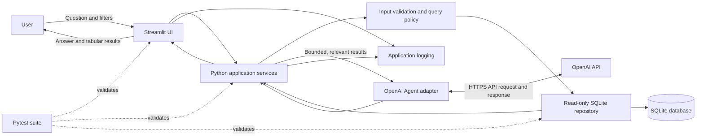
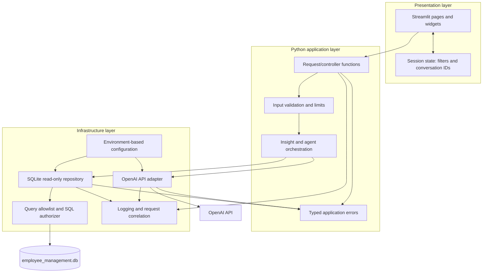
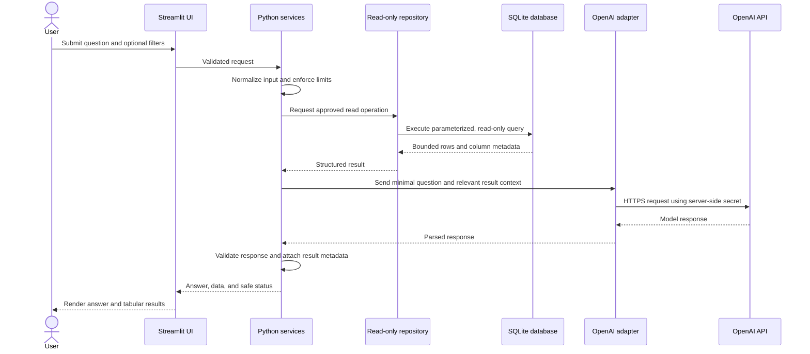

# InsightSQL Technology Architecture

## 1. Purpose and assumptions

InsightSQL is a Python application for exploring a SQLite database through a Streamlit interface, with an OpenAI-powered assistant for natural-language questions. Pytest is used to validate application behavior. The existing employee-management database remains the source of truth.

The application is read-only by default. The OpenAI agent must not receive direct database access or permission to run arbitrary SQL. It may request approved read operations through the Python service layer. SQLite is appropriate for a local, single-user or low-concurrency deployment; a server database should be considered if concurrent writes or multiple application instances become requirements.

## 2. Architecture diagram



## 3. Component diagram



### Component responsibilities

| Component | Responsibility |
|---|---|
| Streamlit UI | Collect user questions and filters; render validated results and safe error messages. It contains no database credentials or SQL-generation policy. |
| Python application services | Validate requests, apply limits, coordinate data retrieval and optional agent calls, and format results for the UI. |
| SQLite repository | Open the configured database read-only, execute approved queries, and return bounded results. |
| Query policy | Restrict access to approved tables, columns, and read operations. Reject writes and unsafe or unbounded queries. |
| OpenAI adapter | Isolate API SDK details, timeouts, response validation, and provider-specific errors from application logic. |
| Configuration | Load paths, API settings, timeouts, and limits from environment or Streamlit secrets. |
| Logging | Record operational events and errors with a request identifier while excluding credentials and sensitive prompt/data content. |
| Pytest suite | Test components independently and together using temporary databases and mocked external API calls. |

## 4. Data flow diagram



The agent is optional: if disabled or unavailable, the application can still provide approved database browsing and deterministic query results. The model response is untrusted input and must be validated before rendering or using it to select another approved read operation.

## 5. Proposed folder structure

```text
Database_Insight/
├── app.py                         # Streamlit entry point
├── pyproject.toml                 # Runtime and development dependencies/config
├── .env.example                   # Safe configuration template; no real secrets
├── .gitignore                     # Ignore secrets, caches, and local artifacts
├── README.md                      # Setup and run instructions
├── ARCHITECTURE.md                # This design
├── data/
│   └── employee_management.db     # Local database; exclude if it contains real data
├── sql/
│   ├── schema.sql
│   └── sample_data.sql
├── src/
│   └── insightsql/
│       ├── __init__.py
│       ├── config.py              # Validated app configuration
│       ├── services.py            # Application use cases and orchestration
│       ├── validation.py          # Request and response validation
│       ├── repositories/
│       │   └── sqlite_reader.py   # Read-only data access and query policy
│       ├── agents/
│       │   └── openai_adapter.py  # OpenAI API boundary
│       ├── errors.py              # Safe, typed application errors
│       └── observability.py       # Logging setup and request IDs
└── tests/
    ├── conftest.py                # Temporary database and shared fixtures
    ├── test_sqlite_reader.py
    ├── test_validation.py
    ├── test_services.py
    ├── test_openai_adapter.py
    └── test_streamlit_smoke.py
```

This is the recommended target layout. The current repository is a smaller prototype; adopting the layout can be done incrementally without moving or modifying the existing database as part of this design.

## 6. Security strategy

1. **Read-only database access:** Open SQLite with URI `mode=ro`, enable `PRAGMA query_only = ON`, and use an authorizer to deny writes, schema changes, attachment, and unsafe pragmas. Do not expose a general-purpose SQL execution tool to the agent.
2. **Approved query surface:** Prefer fixed query templates or a typed query builder. Allowlist tables, columns, sort fields, and filter operators. Bind all values as SQL parameters; identifiers must come from the allowlist, never directly from user or model text.
3. **Bounded resource use:** Enforce row limits, pagination, input length limits, and query timeouts where supported. Avoid returning whole tables or unnecessary columns to the agent.
4. **Protect secrets:** Keep `OPENAI_API_KEY` in environment variables or Streamlit secrets. Never commit secrets, print them, place them in prompts, or send them to the browser. Restrict key access and rotate compromised keys.
5. **Treat external content as untrusted:** User prompts, database text, and model output can contain hostile instructions or markup. Keep agent capabilities narrow, validate model output against a schema, escape rendered HTML, and never execute model-generated code or SQL.
6. **Minimize data disclosure:** Send only fields needed to answer a question. Exclude sensitive fields such as personal contact information or salary unless explicitly authorized and required. Do not log full prompts, credentials, or row contents.
7. **Deployment controls:** Use TLS for hosted access, authenticate users if the app is not local-only, keep dependencies patched, and restrict file-system access to the application and database.
8. **Database file protection:** Treat the SQLite file as sensitive data. Apply OS permissions, backups, retention, and repository ignore rules appropriate to the data. A local database is not a substitute for user-level authorization.

## 7. Logging strategy

- Use Python's standard `logging` module with one application configuration point and module-level loggers.
- Emit structured records where practical: timestamp, severity, logger, event name, request ID, operation, duration, and outcome.
- Log startup/configuration status without logging secret values; log database open/close events and aggregate query timing/row counts.
- Log OpenAI request outcome, latency, and provider request ID when available; do not log API keys, full prompts, model chain-of-thought, or database rows.
- Use `WARNING` for recoverable fallback conditions, `ERROR` with exception context for failed operations, and `INFO` for lifecycle and audit-relevant events.
- Send logs to standard output/error in hosted environments; use bounded rotation for local file logs. Set retention and access controls.
- Never display internal tracebacks or filesystem details to end users. Correlate safe user-facing errors to server-side logs with a request ID.

## 8. Exception handling strategy

Define typed errors such as `ConfigurationError`, `ValidationError`, `DataAccessError`, `AgentUnavailableError`, and `ResponseValidationError`.

| Failure | Handling |
|---|---|
| Invalid user input | Reject before database/API access; show a concise correction message. |
| Missing database or invalid schema | Fail startup or the affected operation clearly; log diagnostic details without exposing sensitive paths to remote users. |
| SQLite read/query error | Roll back any active read transaction if applicable, log the exception with request ID, and return a generic data-access message. |
| OpenAI timeout, rate limit, or service error | Apply bounded retries only for transient failures, with backoff; then return deterministic database results if possible and indicate the assistant response is unavailable. |
| Malformed or unsafe model output | Reject it, do not execute or render as trusted HTML; log a sanitized validation failure. |
| Unexpected programming error | Catch only at the UI/request boundary, log the full traceback server-side, show a generic failure plus request ID, and preserve the original exception for diagnosis. |

Use narrow exception catches close to the operation that can fail. Do not silently substitute empty or success-shaped results for failed database or agent operations.

## 9. Testing strategy

Use Pytest with no live OpenAI calls in the default test suite. Inject a temporary SQLite database and mock the OpenAI adapter.

| Test level | Coverage |
|---|---|
| Unit | Input validation, query allowlists, parameter binding, response parsing, configuration validation, and typed error mapping. |
| Repository integration | Read-only connection behavior; valid reads; missing database behavior; write/schema-change denial; row caps; schema and foreign-key constraints using a temporary database. |
| Service integration | Request orchestration, deterministic fallback when the agent fails, and correct data minimization sent to the agent. |
| UI smoke | Streamlit entry point loads; valid and invalid input show the expected safe state; errors do not expose tracebacks. |
| Security regression | Prompt-injection-like content cannot expand tool permissions; model output cannot trigger SQL writes or arbitrary SQL; secrets and row contents are absent from captured logs. |
| End-to-end optional | Run against a disposable copy of the database; live API tests are opt-in, use a test key, and are excluded from standard CI. |

Run the suite with `pytest -q`. CI should also run formatting/linting and type checks if those tools are adopted, and should never use production data or secrets.
