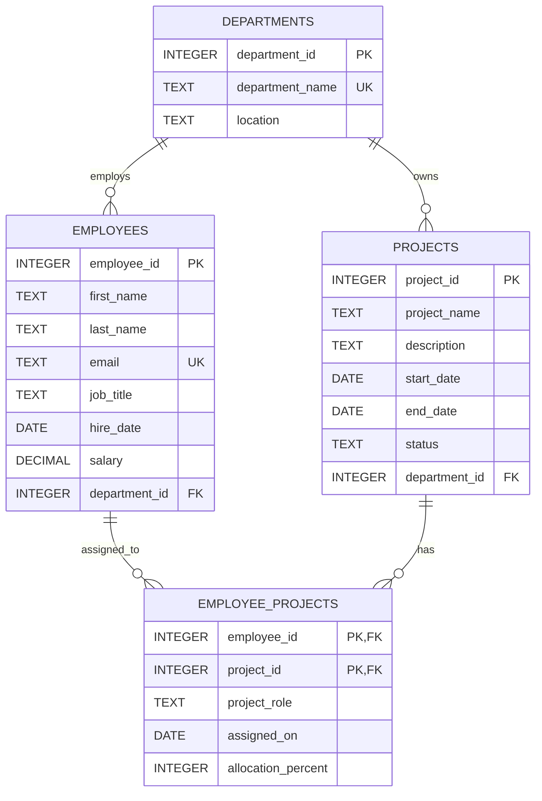

# Employee Management System Database

This example database tracks departments, employees, projects, and employee assignments. The schema and sample data use SQLite-compatible SQL. It is designed as a small, normalized operational schema: department attributes live in `Departments`, and the many-to-many employee/project relationship lives in `Employee_Projects`.

See [ARCHITECTURE.md](./ARCHITECTURE.md) for the proposed InsightSQL architecture, component and data-flow diagrams, security, logging, exception handling, folder layout, and testing strategy.

## ER diagram



## Table definitions and keys

| Table | Purpose and columns | Keys |
|---|---|---|
| `Departments` | `department_id` (integer), `department_name` (text), `location` (text) | Primary key: `department_id`; unique: `department_name` |
| `Employees` | `employee_id` (integer), `first_name` (text), `last_name` (text), `email` (text), `job_title` (text), `hire_date` (date), `salary` (decimal), `department_id` (integer) | Primary key: `employee_id`; unique: `email`; foreign key: `department_id` → `Departments.department_id` |
| `Projects` | `project_id` (integer), `project_name` (text), `description` (text), `start_date` (date), `end_date` (date), `status` (text), `department_id` (integer) | Primary key: `project_id`; foreign key: `department_id` → `Departments.department_id` |
| `Employee_Projects` | `employee_id` (integer), `project_id` (integer), `project_role` (text), `assigned_on` (date), `allocation_percent` (integer, 1–100) | Composite primary key: (`employee_id`, `project_id`); foreign keys: `employee_id` → `Employees.employee_id`, `project_id` → `Projects.project_id` |

`Employees` and `Projects` have a many-to-many relationship represented by `Employee_Projects`. Each department can have multiple employees and projects. Deleting an employee or project removes its assignment rows; department deletion is restricted while employees or projects still reference it. Employee email and department name are unique without regard to letter case. Dates are stored as validated ISO `YYYY-MM-DD` text. Assignment constraints prevent an employee's total allocation across projects from exceeding 100%, and require assignment dates to fall within the project dates.

## Schema and sample data scripts

The SQL is split into two files:

1. Run [`schema.sql`](./schema.sql) against a **new, empty database** to create the tables, indexes, and integrity triggers.
2. Run [`sample_data.sql`](./sample_data.sql) once afterward to insert **5 departments, 20 employees, 10 projects**, and 28 employee-project assignments.

Both scripts use SQLite-compatible SQL and transactions. The sample data script depends on the schema and is intended to be run once per newly initialized database; rerunning it will produce unique-key errors rather than duplicate or overwrite records.

## InsightSQL application

InsightSQL is a Streamlit application that converts natural-language questions into SQLite `SELECT` queries, shows the SQL for review, executes validated queries against the database, displays results, and keeps a per-session query history.

### Setup and run

1. Install Python 3.10 or later.
2. From this folder, create and activate a virtual environment:

   ```powershell
   python -m venv .venv
   .\.venv\Scripts\Activate.ps1
   ```

3. Install application and test dependencies:

   ```powershell
   python -m pip install -e ".[dev]"
   ```

4. In VS Code, run **Python: Select Interpreter** from the Command Palette and select `.venv\Scripts\python.exe`. The workspace default points to this environment; if VS Code already had another interpreter selected, change it once manually.

5. Optionally configure an OpenAI API key in the current PowerShell session:

   ```powershell
   $env:OPENAI_API_KEY = "your-api-key"
   ```

6. Start the application:

   ```powershell
   streamlit run app.py
   ```

Alternatively, start the app without an environment key and enter the key in the password-masked sidebar field. It is used for the current Streamlit session and is not written to the database or logs. Set `INSIGHTSQL_DATABASE` to use a different existing SQLite file, and `OPENAI_MODEL` to select another supported model. The default database is `employee_management.db` in this folder.

### Query safety and history

The app only accepts one `SELECT` statement, restricts database reads to the four employee-management tables, and permits only an explicit set of safe SQLite functions. SQLite is opened in read-only mode with an authorizer and query-only mode; execution has a five-second limit and results are capped at 500 rows. SQL is displayed and editable before execution. Query history is stored in Streamlit session state and is not persisted to the database.

The model generates a SQL candidate but does not execute it or receive database rows. The query goes through local validation and SQLite authorization before execution. Set `OPENAI_API_KEY` outside source control; never put a real key in `.env.example`.

### Tests

Run the test suite with:

```powershell
python -m pytest -q
```

`schema_copy.sql` and `sample_data_copy.sql` are separate copies of the schema and sample data scripts. They are provided as requested; the read-only app does not use or execute them.
