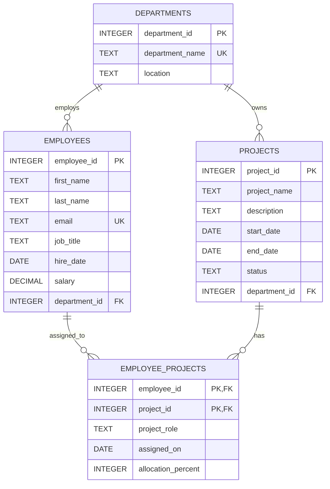

# Employee Management System Database

This example database tracks departments, employees, projects, and employee assignments. The schema and sample data use SQLite-compatible SQL. It is designed as a small, normalized operational schema: department attributes live in `Departments`, and the many-to-many employee/project relationship lives in `Employee_Projects`.

## ER diagram

## Table definitions and keys

| Table | Purpose and columns | Keys |
|---|---|---|
| `Departments` | `department_id` (integer), `department_name` (text), `location` (text) | Primary key: `department_id`; unique: `department_name` |
| `Employees` | `employee_id` (integer), `first_name` (text), `last_name` (text), `email` (text), `job_title` (text), `hire_date` (date), `salary` (decimal), `department_id` (integer) | Primary key: `employee_id`; unique: `email`; foreign key: `department_id` → `Departments.department_id` |
| `Projects` | `project_id` (integer), `project_name` (text), `description` (text), `start_date` (date), `end_date` (date), `status` (text), `department_id` (integer) | Primary key: `project_id`; foreign key: `department_id` → `Departments.department_id` |
| `Employee_Projects` | `employee_id` (integer), `project_id` (integer), `project_role` (text), `assigned_on` (date), `allocation_percent` (integer, 1–100) | Composite primary key: (`employee_id`, `project_id`); foreign keys: `employee_id` → `Employees.employee_id`, `project_id` → `Projects.project_id` |

`Employees` and `Projects` have a many-to-many relationship represented by `Employee_Projects`. Each department can have multiple employees and projects. Deleting an employee or project removes its assignment rows; department deletion is restricted while employees or projects still reference it. Employee email and department name are unique without regard to letter case. Dates are stored as validated ISO `YYYY-MM-DD` text. Assignment constraints prevent an employee's total allocation across projects from exceeding 100%, and require assignment dates to fall within the project dates.

## Schema and sample data scripts

The SQL is split into two files:

1. Run [`schema.sql`](./schema.sql) against a **new, empty database** to create the tables, indexes, and integrity triggers.
2. Run [`sample_data.sql`](./sample_data.sql) once afterward to insert **5 departments, 20 employees, 10 projects**, and 28 employee-project assignments.

Both scripts use SQLite-compatible SQL and transactions. The sample data script depends on the schema and is intended to be run once per newly initialized database; rerunning it will produce unique-key errors rather than duplicate or overwrite records.
